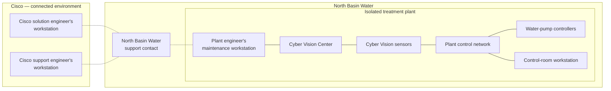

# ConOps Story: Controlled Disconnected Delivery

## New pumps at an isolated treatment plant

North Basin Water is adding water pumps and their controllers at a treatment plant.
Its operators already use Cisco Cyber Vision to understand which industrial devices are present, inspect their communications and investigate unexpected activity.
They need that monitoring to cover the new equipment while continuing to cover the rest of the plant.
The monitoring software observes the control system; the plant's existing controllers and operators continue to run the pumps.

Cisco is the adopting organisation in this counterfactual, and North Basin Water is the customer and business beneficiary.
The customer, operating arrangements, toolkit adoption and events are invented.
The public product setting is narrower: Cisco describes Cyber Vision sensors that analyse industrial traffic and a Center that provides visibility and alerting, with on-premises deployment available.
Those existing capabilities supply the monitoring value in this account, as described in the [Cisco Cyber Vision data sheet].

The plant is isolated from Cisco's connected delivery and support environment.
Its Cyber Vision components communicate locally, collect observations and raise alerts without a live connection to Cisco.
North Basin Water controls the plant infrastructure, schedules local changes and accepts their results.
Customer staff perform the work there, and the customer's support contact arranges exchanges with Cisco.

The delivery follows one existing logical solution: North Basin Water's treatment-plant monitoring.
Adding pumps changes its intended coverage and configuration without creating another solution.
The customer needs useful monitoring during ordinary plant operation; Cisco wants to deliver that change without assigning a specialist to bridge every customer's local installation and disconnected working arrangements.

## Where the engineers and software work

Cisco's solution engineer prepares the change on a connected workstation.
A Cisco support engineer may later examine evidence that North Basin Water supplies.
At the plant, a customer engineer uses a local maintenance workstation to perform the change, while operators use the control-room workstation during water-treatment operation.

The diagram shows placement and local connections, with network detail omitted.
Dashed lines represent customer-arranged transfers of delivery material or selected evidence.
Cisco's workstations have no live connection into the plant.

Cisco's solution engineer understands the monitoring need and curates the solution design.
Cisco's software engineers maintain the reusable software and supported configuration capabilities.
Its platform/service engineers maintain the supported local delivery procedures, while North Basin Water's engineers make plant resources available and execute those procedures.
North Basin Water's operations lead decides whether the monitoring is acceptable for plant use.
These responsibilities remain distinguishable even when one engineer performs several kinds of work.

## Delivery knowledge has to survive the wait

Before adoption, Cisco can already deliver the extension successfully.
The difficulty is coordinating the work across the separation.
A solution engineer may prepare configuration against one software release, a delivery specialist may adapt local scripts, and the plant engineer may receive the material weeks later with an older procedure still installed on the maintenance workstation.
Questions return through the customer's support contact, often after the specialist who prepared the change has moved to another delivery.

Completing the change then depends on people who remember which configuration, procedure and installed state belong together.
Cisco needs staff familiar with each customer's arrangements, and both organisations need an established working relationship to resolve omissions across delayed exchanges.
Repeating that coordination for more customers increases the demand for customer-specific expertise even when the monitoring change uses existing software capabilities.

Cisco adopts the toolkit at the handoff between connected preparation and local execution.
Its delivery tooling uses the toolkit's shared semantics and supported capabilities to produce a portable solution artefact that can stand alone when the preparation session and its live systems are unavailable.
The artefact preserves the solution's durable identity, approved revision and intended software, configuration and relationships, together with versioned instructions for putting that revision into operation.
Local tooling can inspect the meaning of the handoff and check whether the required software and procedure versions are at hand.

Cisco implements the reusable delivery procedures in Go and supplies supported precompiled executables for this episode.
The customer engineer can run them without compiling Go or adapting delivery scripts at the plant.
The portable handoff brings the instructions and version expectations together with the means needed to act on them locally; its physical packaging is left open.
The toolkit supplies common meaning and supported building blocks, while Cisco supplies and supports the local delivery tooling and North Basin Water decides when to use it.

## Cisco prepares the pump-extension revision

The customer gives Cisco's solution engineer the new controller inventory, the intended monitoring coverage and the relevant details of the existing installation.
They agree that the change must add visibility of the new equipment, retain coverage of existing equipment and leave alerts useful to plant operators.
The operations lead approves that intent and a maintenance window for the local work.

The solution engineer revises the existing solution design.
It identifies the Cyber Vision applications and versions to use, the sensor coverage required for the new controllers and the monitoring configuration to apply.
The delivery instructions explain how to check the existing installation, make the required local resources usable, deploy the selected software and verify the result.
This is routine tailoring through supported capabilities; no new monitoring application is developed for the customer.

Cisco validates the prepared revision and its delivery path in its connected environment using the customer-supplied installation information and a representative test setup.
That work can establish that the intended software and procedures fit together under those conditions.
The customer engineers still have to establish whether the actual plant meets the handoff's prerequisites and whether the resulting monitoring is useful there.

The approved handoff names the treatment-plant solution and the pump-extension revision.
It carries the approved design, its applicability to the existing installation and the checks and procedures needed at the plant.
The customer arranges its transfer along with the software needed for local execution.
Neither organisation assumes that the later maintenance session can consult Cisco's build service, retrieve missing dependencies or ask the original specialist for immediate help.

## A missing procedure is found before the change

At the plant, the customer engineer opens the handoff on the maintenance workstation.
The local delivery tool identifies the treatment-plant solution, compares the recorded installation with the revision's prerequisites and checks the available application and procedure versions.
The required provisioning procedure is newer than the executable installed on that workstation.

The engineer defers the affected work before changing the installation.
Through the customer's support contact, the engineer returns the solution identity, the intended revision and the missing procedure version to Cisco.
Cisco can supply the supported executable without first reconstructing which delivery the request concerns.
The customer arranges another transfer and schedules the work to resume.
The approved solution revision remains the same: supplying a missing prerequisite has not changed the intended monitoring design.

At the resumed window, the checks pass.
The plant engineer makes the required local collection connectivity and capacity usable, deploys the selected sensor software and applies the monitoring configuration through the supported procedures.
The existing Center receives observations from the new coverage.
The engineer records the application versions actually observed in operation against the approved solution revision, including unchanged applications that continue to serve it.
This provides the relevant software provenance from intended applications and versions to their observed counterparts.

The engineer and operators confirm that the new controllers are visible and that existing plant coverage remains available.
They capture a commissioning baseline during the daytime run and check that local alerts can be reviewed.
The operations lead accepts the deployed change on that evidence, and the customer returns the acceptance record to Cisco.
The record describes the scope actually exercised; the standby pump has not yet run through its normal night-shift changeover.

## The night shift exposes an incomplete baseline

On the first night shift after commissioning, the plant switches from its duty pump to its standby pump.
Cyber Vision raises an alert about communications between the control-room workstation and the standby pump's controller.
The operator recognises the scheduled switch but cannot tell why normal plant operation has triggered the alert.
The monitoring service has detected a difference; the plant must decide what that difference means.

The plant engineer checks the commissioning record.
The controller belongs to the approved monitoring revision, but the recorded baseline was captured while only the duty pump was running.
Before changing the monitoring settings, the engineer asks North Basin Water's support contact to open a case with Cisco.

The customer selects the alert and relevant activity records, adds the accepted solution revision and observed application versions, and explains when the pump switch occurred.
It releases that material through its support contact.
Cisco's support engineer receives a bounded account of the installation and event, rather than access to the plant or a continuous feed of its telemetry.
If more evidence is needed, the request returns to the customer for local collection and a further release decision.

The support engineer relates the evidence to the delivered design and identifies the missing operating state in the monitoring configuration.
The intended coverage includes the new pump controllers, but commissioning represented only duty-pump operation.
Cyber Vision already supports baselines for known operating states and alerts on deviations, as explained in [Cisco's monitoring guide][Cisco-monitoring-guide].
The toolkit has helped preserve the context needed to use that capability; it has not supplied the monitoring analysis or decided which plant behaviour is normal.

Cisco recommends a correction that includes reviewed standby operation while retaining alerts for unexpected communications.
North Basin Water's plant engineer and operators assess that recommendation against their operating practice.
After they agree the intended change, Cisco's solution engineer prepares a corrected revision of the same solution with revised monitoring configuration and commissioning instructions covering the duty-to-standby switch.
The software versions can remain unchanged even though the solution revision changes.

Customer staff receive and validate the new handoff, apply the correction locally and review observations from the next scheduled switch.
They confirm that the expected communications are represented by the appropriate operating baseline and that monitoring for other differences remains enabled.
The customer accepts the correction and returns the resulting evidence to Cisco.
That evidence qualifies the earlier daytime acceptance with experience from actual plant use.

## The division of work remains material

Cisco remains accountable for the supported software, delivery procedures, solution design and vendor support it supplies.
North Basin Water retains the local knowledge needed to interpret plant operation, controls its infrastructure, authorises and performs local changes, accepts deployment and decides what evidence leaves the plant.
The portable handoff makes their work easier to connect across time and place without giving either party the other's decisions.

This allocation differs from the adopter-owned platform and deployment-acceptance model in [M-01 § System boundary and operating model][M-01-boundary].
Here, platform/service engineering work crosses the organisational boundary: Cisco supports the means of delivery, and the customer prepares and controls the target environment.
The common allocation of these responsibilities across vendor-operated and customer-operated settings remains unresolved.

The episode assumes an existing Cyber Vision installation and supported means of making the required software and executables locally usable.
It does not establish that a particular product release or commercial offering supports every disconnected arrangement described here.
Transfer media, package composition, cryptographic mechanisms, offline dependency distribution, schemas, protocols and reconciliation implementation remain open.
Those choices must preserve the handoff's meaning and local usability, but this account does not select them.

## The same outcome with less customer-specific expertise

Cyber Vision supplies the plant's visibility and alerts, and customer operators turn those observations into useful operational decisions.
The project changes the delivery work needed to maintain that value across the separation.
The plant engineer can identify a missing executable before changing the installation, carry out a supported procedure when it becomes available and return evidence that Cisco can relate to the intended revision.
A support engineer can investigate the later alert without asking a customer-specific delivery specialist to reconstruct the installation.

Cisco still has to develop and support the reusable procedures, and both organisations have to maintain the local tooling and arrange transfers.
Missing prerequisites can delay a maintenance window, and unfamiliar operational behaviour can still need specialist support.
The initial acceptance also shows the limit of a technically complete handoff: preserving approved intent cannot make incomplete commissioning evidence cover an untested operating state.

The intended organisational gain is a lower level of customer-specific expertise and coordination needed to achieve the same delivery and support outcome.
Assessing that gain would require observing how often routine deliveries complete through the supported path, why specialists are still needed and how much installation context has to be reconstructed during support.
One invented episode supplies no measured reduction or portfolio-wide proof.

The operational significance is the continuity of one customer solution through connected preparation, delayed local execution and customer-mediated support.
The solution artefact lets people act on approved delivery knowledge when its authors and live systems are absent, and lets the evidence from plant use return to the same solution's history and subsequent design.

[M-01-boundary]: M-01-business-mission-analysis.md#system-boundary-and-operating-model
[Cisco Cyber Vision data sheet]: https://www.cisco.com/c/en/us/products/collateral/security/cyber-vision/cyber-vision-ds.html
[Cisco-monitoring-guide]: https://www.cisco.com/c/en/us/td/docs/security/cyber_vision/Release-5-2-0/b-cisco-cyber-vision-administration-guide-release-5-2-0/m-maintain-and-monitor-cisco-cyber-vision.html
